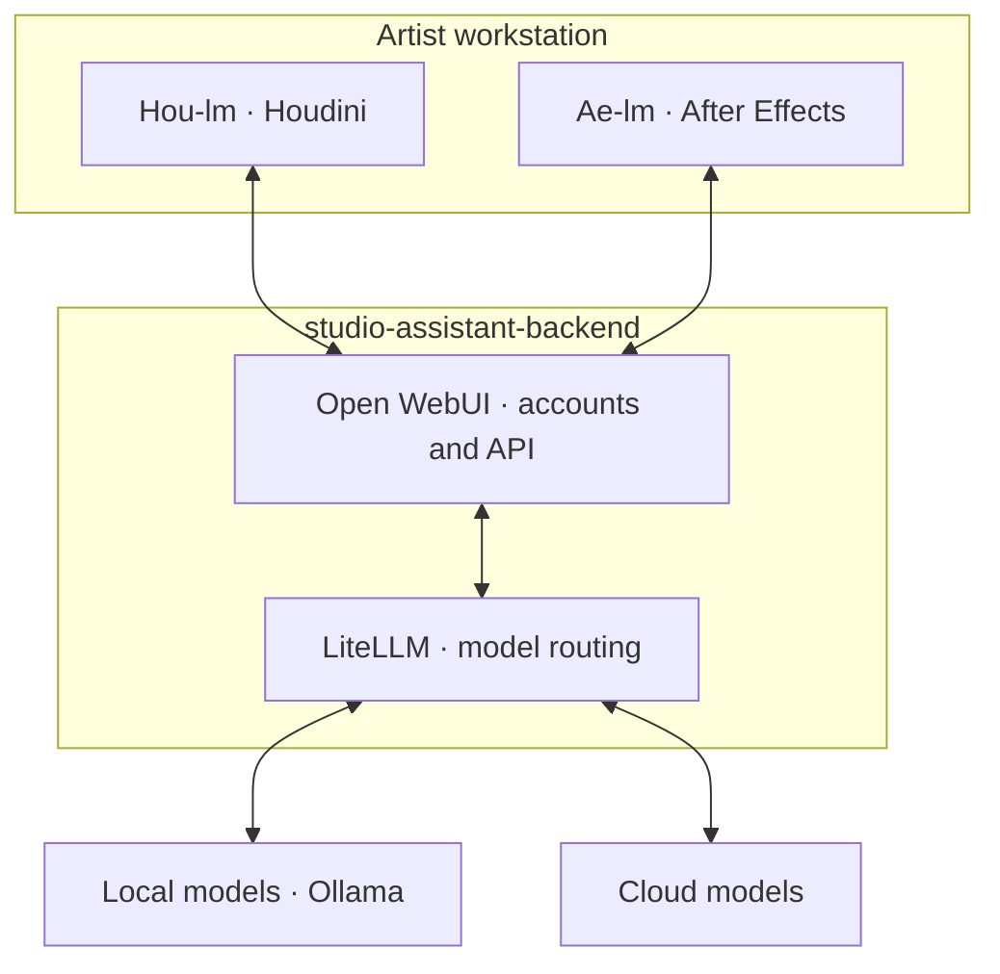

# Studio assistant backend

Shared model service for the **[Hou-lm / Houdini](https://github.com/Byter3/Hou-lm)** and **[Ae-lm / After Effects](https://github.com/Byter3/Ae-lm)** clients.

## Architecture

Clients send context, images and tool results through the service. Commands execute locally in Houdini or AE. The Compose example supplies Open WebUI, LiteLLM, PostgreSQL and GPU-backed Ollama; an existing compatible service can also serve the clients.

## Setup

1. Follow [server setup](docs/server-setup.md) to deploy and configure models.
2. Give artists the Open WebUI base URL and their user API keys.
3. Install [Hou-lm](https://github.com/Byter3/Hou-lm/blob/main/docs/package-install.md) or [Ae-lm](https://github.com/Byter3/Ae-lm/blob/main/docs/install.md) on workstations.

Models need tool-call support; visual workflows also need image input. Backend files are not required on artist workstations.

[Existing stack updates](docs/migration.md) · [Optional LiteLLM stream adapter](gateway/README.md) · [Development](CONTRIBUTING.md) · [Security](SECURITY.md) · [MIT](LICENSE)
